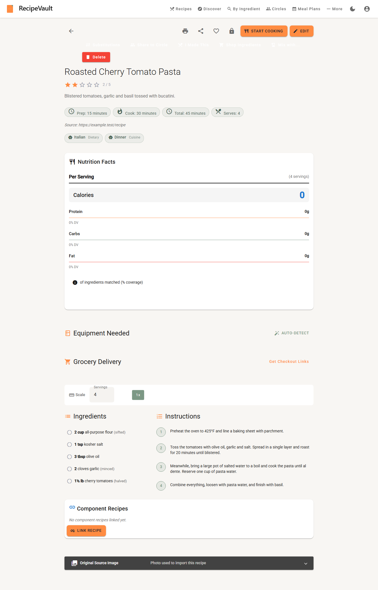
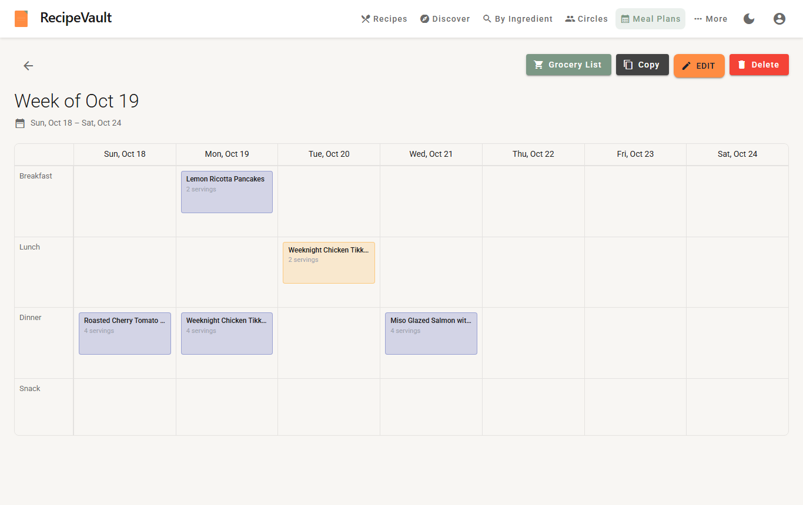

# UI Design Review — whole app (October 18, 2026)

**Scope:** 16 screens (login, features, recipes, recipe detail, new recipe, cooking mode, discover, by ingredient, meal plans, meal plan detail, grocery list, circles, stats, settings, collections), each captured at 1366×860 and 390×844, in light and dark themes (64 captures).
**Method:** The Angular dev server ran against faked Supabase auth and fixture API responses ([capture.mjs](2026-10-18-ui-review/capture.mjs)). The script also checked WCAG contrast on every visible text node and flagged icons rendering in the wrong font. Key screenshots are in [screens/](2026-10-18-ui-review/screens/).
**Caveat:** Fixture data, not the real API. Layout, colour and type findings don't depend on the data. The meal-plan date finding needs a quick check against the real API (see C3).

---

## Overall impression

The pieces are good: a real token file, warm brand colours, consistent recipe cards and a clean pricing page. The biggest problem is that **light mode is broken across the app.** Angular Material is themed dark everywhere, but the page defaults to light. So any Material component the tokens don't override renders white text on a white background. About 30 buttons can't be seen, including the main actions on recipe detail. The second-biggest problem is **hierarchy on recipe detail:** 13 actions plus the nutrition, equipment and grocery panels come before the ingredients.

---

## 🔴 Critical

### C1. Light mode uses Material's dark theme: buttons are invisible
[theme.scss:92](../../../ui/src/theme.scss) builds `m2-define-dark-theme` and applies it globally. But `_tokens.scss` defaults to light, and `ThemeService` follows the OS (light for most people). Any Material component without a token override keeps dark-theme colours on a light page.

The contrast audit found these at **~1.0:1** in light mode, so they are effectively invisible:

| Screen | Invisible controls |
|---|---|
| Recipes | Card **View / Edit**, **Filter by Equipment** |
| Recipe detail | **Substitutions, Share to Circle, I Made This, Shop Ingredients, Mix with…**, **Recalculate**, scale **½x / 2x / 3x** |
| New recipe | **Add Ingredient, Add Instruction, Cancel**, "Make this recipe public" label |
| Cooking mode | **Read Step Aloud** |
| Discover | Sort select ("Newest"), **View** |
| By ingredient | **Load my pantry into search** |
| Meal plans | **View / Edit / Copy** |
| Settings | **Sign Out** |

Expansion panels also render dark grey (#424242) on the light page: Grocery List categories and By Ingredient "Filters". The quantities inside them sit at 2.0:1.



**Fix:** Build both themes and switch colours only:
```scss
$light: mat.m2-define-light-theme((color: (primary: $kite-primary, accent: $kite-accent, warn: $kite-warn), typography: ..., density: 0));
$dark:  mat.m2-define-dark-theme((color: (primary: $kite-primary, accent: $kite-accent, warn: $kite-warn)));
@include mat.all-component-themes($light);
.dark-theme { @include mat.all-component-colors($dark); }
```
Then remove the hard-coded `#1a2230`, `#64748b` and `#ffffff` overrides in `theme.scss` that were added to fight the dark base. Re-run `capture.mjs`: `contrast.txt` should have no entries below 3:1.

### C2. Cooking mode's Previous/Next buttons show "na" instead of arrows
At [cooking-mode.component.scss:136](../../../ui/src/app/components/recipes/cooking-mode/cooking-mode.component.scss), `mat-icon { font: var(--font-h2); }` uses the `font` shorthand. That resets `font-family` to Roboto, so the ligature names `navigate_before` and `navigate_next` render as text clipped to 1.5rem. This happens in every theme and viewport. These are the two most-used controls on the screen people use with messy hands.
**Fix:** Use `font-size: 24px` (or `font-size` from the token) instead of `font:`.

### C3. The meal plan grid shows every meal one day early (US time zones)
"Week of Oct 19" renders as **Sun Oct 18 – Sat Oct 24**, and every entry sits one column early (pancakes planned for Tue the 20th appear under Mon the 19th).
Cause: the columns are DateTimes stored as `timestamp with time zone`, so the API returns `…T00:00:00Z`, and [meal-plan-detail.component.ts:89-96](../../../ui/src/app/components/meal-plans/meal-plan-detail/meal-plan-detail.component.ts) parses them with `new Date(...)`, which moves UTC midnight back to the previous evening anywhere west of UTC. Lines 134, 153, 167 and 182 then save those shifted dates, so editing a plan can move entries for real.
**Fix:** Treat plan dates as calendar dates. Parse the `YYYY-MM-DD` part into a local date (`new Date(y, m-1, d)`), or return `DateOnly` from the API. *Verify against the real API first. The fixture used the date-only format.*



### C4. Dark mode: nutrition and card meta are unreadable
- **Nutrition panel:** the Calories row has a white background with a white "Calories" label (1.0:1). The gram values are #424242 on slate (1.03:1). "(4 servings)" and "% DV" are 1.7:1.
- **Recipe and Discover cards:** the "45 min" / "4 servings" chips are 1.4:1. The chip text is hard-coded `#4a6354 !important` (in `theme.scss` and `discover.component.scss:212-228`), so it never adapts to dark mode.


---

## Usability

| Finding | Severity | Recommendation |
|---|---|---|
| **Recipe detail buries the recipe.** Above the title sit 4 icon buttons, 2 orange primaries (Start Cooking, Edit), 5 secondary buttons and a filled red **Delete**. Then come the Nutrition, Equipment and Grocery Delivery panels. Ingredients start ~1,500px down on desktop and on mobile. | 🔴 | Order: title → rating/meta → **Ingredients + Instructions** → nutrition/equipment/grocery (or a side column on desktop). Make one primary (Start Cooking) and make Edit secondary. Move the other actions and Delete into an overflow menu. |
| **Delete is styled as a primary action** (filled red, beside the title on recipe detail and in the meal plan header). | 🟡 | Put destructive actions in the overflow menu and confirm before deleting. Never put them in the main action row. |
| ~~**The nutrition empty state looks broken.**~~ **Withdrawn:** the zeroed panel came from the capture script's fixture data. The script returned an empty list object for the nutrition endpoint, and the panel treats any object as data. The panel already has a "not calculated" empty state (`nutrition-panel.component.html:27`). | — | Make the fixture return 404 for nutrition. Still true: the panel sits above the ingredients (see the first row). |
| **Mobile recipe list:** the header stacks into 6 rows (title, toggle, a lone heart, search, full-width AI Generate, full-width New Recipe). Then each card has a 200px placeholder, so about 1.3 recipes fit per screen. | 🟡 | Put title and search on one row and the toggle and favourites on another. Use a New FAB with AI Generate inside it. Use a compact row or 2-column layout on mobile, and a short placeholder when there's no photo. |
| **Mobile navigation** is a hamburger menu with 11 ungrouped items. Cooking mode keeps the full app toolbar. | 🟡 | Add a bottom nav for Recipes, Discover, Meal Plans, Circles and More. Make cooking mode full-screen. |
| **Login:** the main button sits greyed out (disabled) until the form is valid, so it looks broken. "Continue as guest", the lowest-friction path, is the last line on the card. | 🟡 | Keep Sign In enabled and validate on submit. Raise the guest option for first-time visitors. Shrink the 100px hero logo (flagged in the March review too). |
| Meal plan leftovers are tinted orange with no legend. Truncated titles have no tooltip. | 🟢 | Add a small legend or a "Leftover" label, and a `title` attribute on truncated entries. |

## Visual hierarchy

- **What draws the eye first:** On Recipes, the orange **New Recipe** button. That's correct. On recipe detail it's the red **Delete** and two competing orange buttons. That's wrong: it should be the title and Start Cooking.
- **Reading flow:** Lists, Features and Cooking Mode read cleanly top to bottom. Recipe detail and the meal plan header put a row of actions ahead of the content.
- **Emphasis:** The meal plan header uses four button treatments side by side (sage filled, near-black filled, orange raised, red filled). Grocery List adds two more near-black filled buttons. The system needs one rule: **one** orange primary per view, outlined secondaries, text tertiaries, and destructive actions in a menu.

## Consistency

| Element | Issue | Recommendation |
|---|---|---|
| Spec vs. build | [01-foundation.md](../01-foundation.md) still says *dark-only, amber #f59e0b + teal #14b8a6, light theme "future phase"*. The build is light-default, orange #ff8c42 + sage #7c9885. The old teal and amber still appear in the onboarding dialog, tour tooltip, beta invite dialog and upgrade banner. | Update the foundation doc to v2 as built and sweep the four leftovers. |
| Hard-coded values | Component SCSS has 185 hex literals, 119 `rgba()` literals and 109 `!important` (vs 1,449 `var(--…)` uses). The worst files: dietary-warning (24), recipe-list (16), recipe-links (14), discover (14). | Most `!important` exists to fight the dark Material base (C1). After C1, replace literals with tokens file by file. |
| Type scale | `font-size: 0.75rem` (12px) appears 11 times, against the doc's 14px minimum. There are 12 distinct ad-hoc sizes alongside the token scale. | Use the `--font-*` tokens only. Allow caption (12px) for metadata only, never for body copy. |
| Form fields | Fields are filled in light mode and outlined in dark mode on the same login screen. | Pick one appearance for both themes. |
| Meta chips | Time and servings on cards are bordered pills that look tappable but aren't. Tags, which are tappable elsewhere, don't show on cards. | Show time and servings as plain icon+text metadata. Use chips only for tags and filters. |

## Accessibility

- **Colour contrast (fails):**
  - Brand orange **#ff8c42 as text is 2.3:1** ("Step 1", prices, "Get Checkout Links", "See what's included →", "Create your first collection").
  - Sage **#7c9885 as text is 2.7–3.1:1** (active nav item, "Forgot password?", "Sign up", step numbers).
  - Hint grey **#9ca3af is used for real content at 2.5:1** (Settings descriptions, the user's email, "Created" date, meal-plan servings, fork counts).
  - Dark mode: `#64748b` on slate-700 is 2.2:1 ("or", fork counts, helper text).
  Add text-safe tokens and keep the bright colours for fills:
  - `--color-primary-on-light-text: #b5541a` (4.9:1 on white, 4.6:1 on bg-secondary)
  - `--color-accent-text: #4a6354` (6.6:1)
  - Use `--color-text-secondary` (#6b6b6b, 5.3:1) instead of hint for anything that isn't placeholder text.
  Orange text on dark backgrounds is fine (6.3:1), and dark text on orange buttons is fine (6.9:1).
- **Touch targets:** Card heart toggles and recipe-detail icon buttons are 40px (OK). The scale buttons ½x–3x measure ~34px tall in the captures (below 44px on mobile).
- **Text readability:** Instructions are 14px on desktop. For a recipe read from across a kitchen, use body-large (16px) on detail and keep cooking mode's large type.
- **Good:** a global `:focus-visible` outline, `aria-label`s on the theme and account icon buttons, and real checkboxes for ingredients.

## What works well

- **The token foundation is solid:** spacing, type, radius, shadow and motion scales, with real adoption (1,449 `var()` uses).
- **The Features/pricing page** is the most polished screen: clear "Remix" story, a scannable comparison table, and a "Best value" annual card.
- **Cooking mode's step card:** large instruction text and a clear "Step 1 of 4" are right for kitchen distance.
- **Recipe cards** follow one consistent structure, and the warm gradient placeholders keep image-less libraries from looking broken.
- **Dark mode** (apart from C4) reads as one coherent system: slate surfaces with orange and sage accents.

## Priority recommendations

1. **Fix the Material theme base (C1).** One SCSS change fixes about 30 invisible controls and lets you delete most `!important` overrides. Re-run `capture.mjs` and target zero contrast entries below 3:1.
2. **Fix the three broken behaviours:** cooking-mode icons (C2, one line), meal plan dates (C3) and dark-mode nutrition and chips (C4).
3. **Restructure recipe detail:** ingredients and instructions first, one primary action, Delete in an overflow menu, and supporting panels moved below the recipe.
4. **Add text-safe orange and sage tokens** and stop using hint grey for content.
5. **Do a mobile pass:** compact recipe list header and cards, bottom nav, full-screen cooking mode.
6. **Bring `01-foundation.md` up to date** with what was built, then sweep the hard-coded colours.

---

### Re-running the capture
```bash
# with `npm start` running in ui/
node docs/designs/reviews/2026-10-18-ui-review/capture.mjs <out-dir> [screen,screen,...]
```
It writes `<viewport>-<theme>-<screen>.png` and `contrast.txt` (every text node below WCAG AA), and logs any icon that isn't rendering in the Material Icons font.
